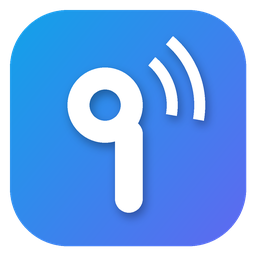
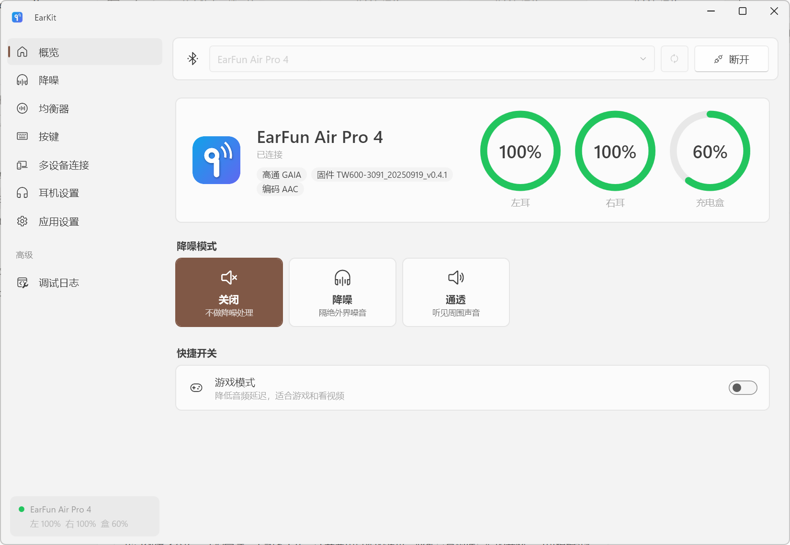
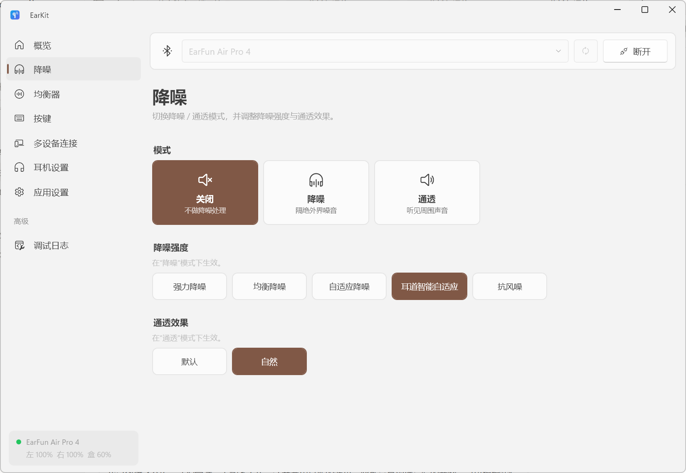
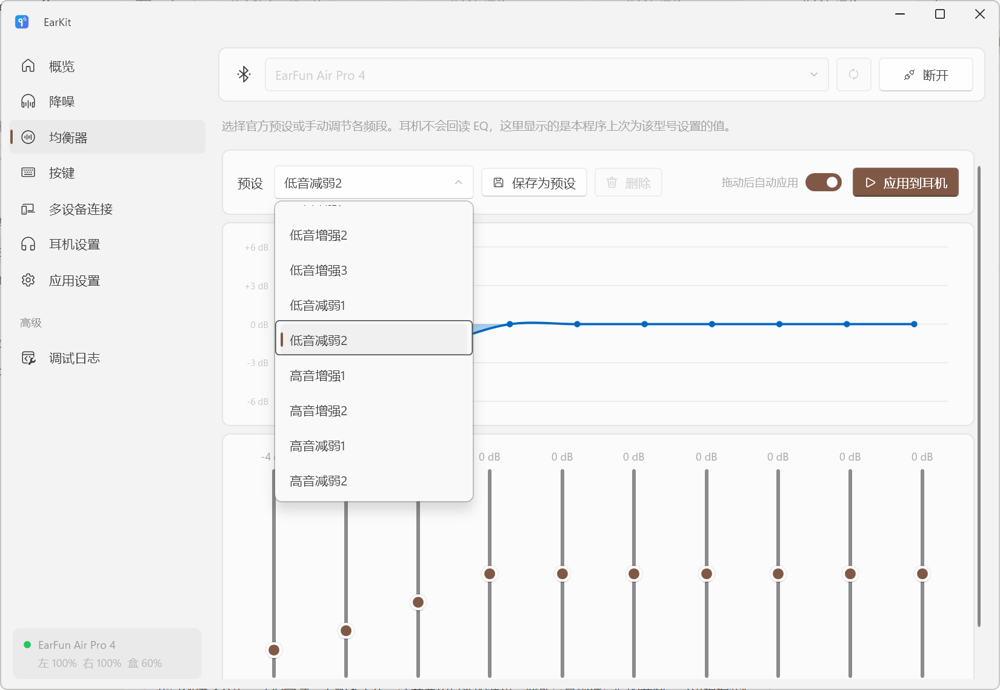
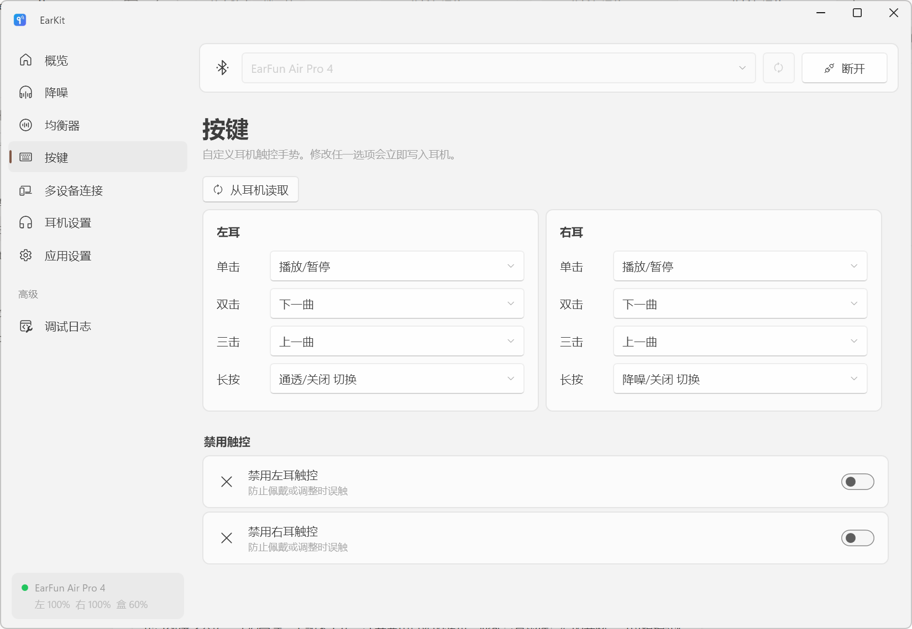
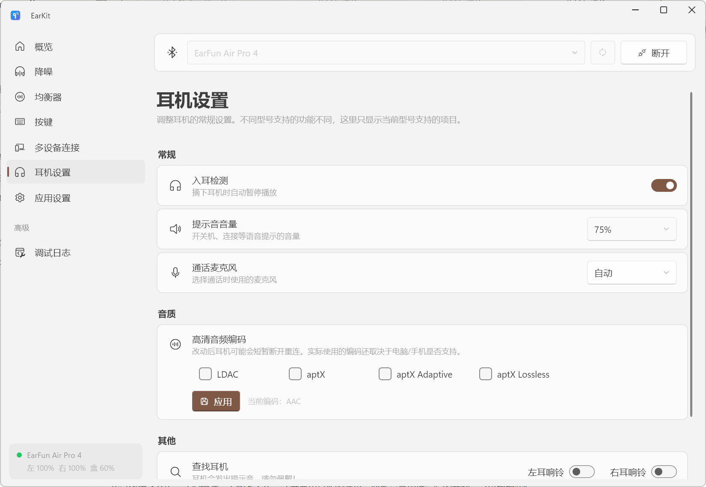

<h1 align="center">NOTE:</h1>
<p align="center">
This is an English translated fork of "ChuiFeng-wind/EarKit". I'm not the original author. <br>
I don't intend to maintain it. Just for personal use. 
</p>

<p align="center">
  
</p>

<h1 align="center">EarKit</h1>

<p align="center">
  Control your EarFun headphones on Windows: noise cancellation, equalizer, button controls, and multipoint connections—all from the system tray.
</p>

<p align="center">
  <a href="../../releases/latest"></a>
  
  
  <a href="LICENSE"></a>
</p>

> [!IMPORTANT]
> **EarKit is an unofficial, third-party open-source project** and is not affiliated with, endorsed by, or sponsored by EarFun. “EarFun” and its product names are trademarks of their respective owners and are mentioned only to describe compatibility. Please do not contact EarFun customer support about issues with this software.

---

## 📸 Screenshots

<p align="center">
  
</p>

| Noise cancellation | Equalizer |
|:---:|:---:|
|  |  |
| **Controls** | **Headphone settings** |
|  |  |

## ✨ Features

| Page | Features |
|---|---|
| **Overview** | Left, right, and case battery levels; connection status; firmware version |
| **Noise cancellation** | Noise cancellation / transparency / off; noise-cancellation modes (balanced, adaptive, wind reduction, etc.); transparency modes (default / natural) |
| **Equalizer** | Official presets, drag-to-adjust controls, real-time curve; save and manage custom presets |
| **Controls** | Customize single-click, double-click, triple-click, and long-press actions for each earbud |
| **Multipoint** | View connected phones and computers, switch or disconnect devices, and enter pairing mode; LDAC conflict warnings |
| **Headphone settings** | Game mode, audio codec (LDAC / aptX / adaptive / lossless), prompt volume, Find My Earbuds, microphone, wear detection, auto power-off, and more (model-dependent) |
| **App settings** | Dark / light / follow system; Mica / Acrylic backgrounds and opacity; launch at startup, tray, notifications, and hotkeys |
| **Debug log** | View raw data sent and received, send commands manually, and export logs |

**Always available in the system tray**

- Closing the window minimizes the app to the tray; hover to see battery levels and the current noise-cancellation mode.
- Use the context menu to quickly switch noise-cancellation or game modes, or reconnect.
- Cycle through noise-cancellation modes with the global <kbd>Ctrl</kbd> + <kbd>Alt</kbd> + <kbd>N</kbd> hotkey (customizable).
- Automatically connect when the headphones connect to the computer and receive low-battery alerts.

## 🎧 Supported models

23 models are supported, using either the Qualcomm GAIA or EF protocol. EarKit detects the model automatically.

| Qualcomm GAIA protocol | EF protocol |
|---|---|
| Air Pro 4 ✅ Tested | Air Pro 4i |
| Air Pro 4+ | Air 2 NC / Air 2 NC (VDL) |
| Air Pro 4+ AI | Air Life |
| Air Pro 5 | OpenJump / OpenJump (new model) |
| Air Pro 3 / Air Pro 3 (3072) | Clip / Clip 2 |
| Free Pro 3 | Wave Life |
| Air S / Air S (TW201) | Tune Pro |
| Free 2S | Wave Pro 2 |
| Wave Pro X | |
| ATVEL Tune S5 ProX | |

Models not marked as tested have not been verified on physical devices. If you have tried EarKit with any other model, please share your feedback in [Issues](../../issues), whether it worked or not.

## 📥 Installation

1. Go to [Releases](../../releases/latest), download `EarKit-x.y.z-Setup.exe`, and run it.
2. The installer is not digitally signed. Windows may display “Windows protected your PC”; select **More info → Run anyway** to continue.
3. If the .NET 10 Desktop Runtime is missing, the installer will install it automatically.

**System requirements**: 64-bit Windows 10 version 2004 or later. Mica / Acrylic backgrounds require Windows 11 version 22H2 or later.

## 🚀 Usage

1. Pair and connect your headphones in Windows **Settings → Bluetooth & devices**.
2. Open EarKit, select your headphones at the top, and click **Connect**.
3. EarKit will remember your headphones and connect automatically the next time they connect to the computer.

## ❓ FAQ

<details>
<summary><b>Connection fails or remains stuck on “Connecting”</b></summary>

- The headphone control channel can usually be used by only one device at a time. **Close the EarFun app on your phone** first; if needed, disconnect Bluetooth on the phone and try again.
- Make sure the headphones show as “Connected” in Windows Bluetooth settings.
- If the issue persists, try connecting through a Bluetooth COM port in **App settings → Connection method (advanced)**.
</details>

<details>
<summary><b>The detected model is incorrect or some features are missing</b></summary>

Manually select the correct model in **App settings → Headphone model**.
</details>

<details>
<summary><b>EarKit cannot be found / It is missing from the Start menu</b></summary>

Select “Start Menu shortcut” during installation (selected by default). If you skipped it, run the installer again and select it; your settings will be preserved.
</details>

<details>
<summary><b>Are factory reset and “Unlock all features” safe?</b></summary>

These actions may erase headphone settings or cause features to malfunction. Use them with caution and at your own risk. “Unlock all features” displays options not declared as supported by the current model, for testing only.
</details>

## 🗂️ Data locations

| Data | Location |
|---|---|
| Settings and custom equalizer presets | `%AppData%\EarKit\settings.json` |
| Crash log | `%AppData%\EarKit\crash.log` |
| Launch-at-startup entry | `HKCU\Software\Microsoft\Windows\CurrentVersion\Run` → `EarKit` |

Command-line argument `--tray`: show only the tray icon at startup without opening a window.

You can choose whether to delete this personal data when uninstalling.

## 🛠️ Building from source

Requires the [.NET 10 SDK](https://dotnet.microsoft.com/download/dotnet/10.0) and [NSIS 3](https://nsis.sourceforge.io/) (required to build the installer).

```powershell
git clone https://github.com/ChuiFeng-wind/EarKit.git
cd EarKit

./build.ps1                 # Creates dist\EarKit-<version>-Setup.exe
./build.ps1 -NoInstaller    # Publishes the app to publish\ only
cd src/EarKit; dotnet run   # Runs the app for debugging
```

After you push a `v*` tag, GitHub Actions automatically builds the installer and creates a draft release.

**Project structure**

```
src/EarKit/
├─ Core/        Model catalog, protocol encoding/decoding (Qualcomm GAIA / EF), Bluetooth RFCOMM connection
├─ Services/    Device control, tray, global hotkeys, settings, background effects
├─ Controls/    Custom-drawn controls such as battery rings and EQ curves
└─ Pages/       Feature pages
installer/      NSIS installer script and installer license
```

Tech stack: C# · .NET 10 · WPF · [WPF UI](https://github.com/lepoco/wpfui) · [H.NotifyIcon](https://github.com/HavenDV/H.NotifyIcon)

## 🐞 Reporting issues

Please include the following in [Issues](../../issues):

- Headphone model and Windows version
- A screenshot of the issue
- The log exported from the **Debug log** page
- If the app crashed, attach `%AppData%\EarKit\crash.log`

## 📄 License

- EarKit is released under the [MIT License](LICENSE) and is provided “as is,” without warranty.
- See [THIRD-PARTY-NOTICES.txt](THIRD-PARTY-NOTICES.txt) for licenses of third-party components.
- The Microsoft .NET Desktop Runtime bundled with the installer is subject to the [.NET Library License](https://dotnet.microsoft.com/dotnet_library_license.htm) and is redistributed as-is.
